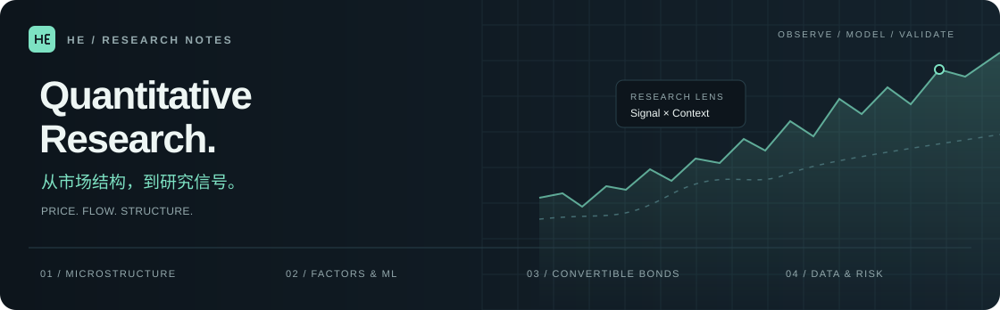

<picture>
  <source media="(prefers-color-scheme: dark)" srcset="assets/header-dark.svg">
  <source media="(prefers-color-scheme: light)" srcset="assets/header-light.svg">
  
</picture>

  <a href="#research--研究方向">Research · 研究方向</a> &nbsp; / &nbsp;
  <a href="#featured--公开项目">Featured · 公开项目</a> &nbsp; / &nbsp;
  <a href="#exploring--持续探索">Exploring · 持续探索</a>

研究中国股票与可转债的量价结构、因子建模与风险分析，关注数据质量、可复现评估，以及从研究想法到可维护工具的实现。

*Exploring price–volume structure, factor modeling and risk in Chinese equities and convertible bonds, with a focus on data quality, reproducible evaluation and maintainable research tools.*

## Research · 研究方向

| 方向 / Focus | 关注的问题 / Questions |
| :-- | :-- |
| **市场微观结构 · Microstructure** | 订单流、撤单与成交结构中，有哪些值得检验的信息？ What can order flow, cancellations and trade structure tell us? |
| **因子与机器学习 · Factors & ML** | 如何把量价特征转化为可验证的研究信号？ How can price–volume features become testable research signals? |
| **转债与风险 · Convertible bonds & risk** | 如何理解条款、估值、Greeks 与风格暴露？ How do terms, valuation, Greeks and style exposures interact? |
| **数据与评估 · Data & evaluation** | 如何追踪来源、检验口径并让结果可以复现？ How can we trace sources, validate conventions and reproduce results? |

## Featured · 公开项目

### [quant_signal ↗](https://github.com/1191008459/quant_signal)

**从信号发布到表现与暴露的持续跟踪。**

按日期归档股票信号，提供字段说明、文件校验信息、历史表现与风格/行业暴露，让发布内容与后续评估可以对应。

*A dated archive of equity signals, with documented fields, file checksums, historical performance and style/industry exposure tracking.*

  <a href="https://github.com/1191008459/quant_signal/tree/main/signals">信号归档 · Signal archive ↗</a> &nbsp; · &nbsp;
  <a href="https://github.com/1191008459/quant_signal#已发布信号的历史表现">表现跟踪 · Performance ↗</a> &nbsp; · &nbsp;
  <a href="https://github.com/1191008459/quant_signal/tree/main/exposure">风险暴露 · Exposures ↗</a>

查看项目图表 · View project charts

 

图表来自项目仓库，样本、计算口径与局限请见项目说明。 
*Charts are maintained in the project repository. See its README for sample coverage, methodology and limitations.*

## Exploring · 持续探索

关注并通过 fork 跟踪的开源项目： 
*Open-source projects I follow through forks:*

| 项目 / Project | 研究兴趣 / Interest |
| :-- | :-- |
| [Qlib](https://github.com/microsoft/qlib) | 机器学习量化研究流程 · ML-driven quantitative research |
| [AlphaGen](https://github.com/ICT-FinD-Lab/alphagen) | 公式化因子生成 · Formulaic alpha generation |
| [KunQuant](https://github.com/Menooker/KunQuant) | 金融表达式的编译与执行 · Compiling and executing financial expressions |
| [QuantsPlaybook](https://github.com/hugo2046/QuantsPlaybook) | 量化研究与研报复现 · Quant research and report replication |

---

  <strong>保持好奇，检验假设，追踪证据。</strong> 
  Stay curious. Test assumptions. Follow the evidence.

